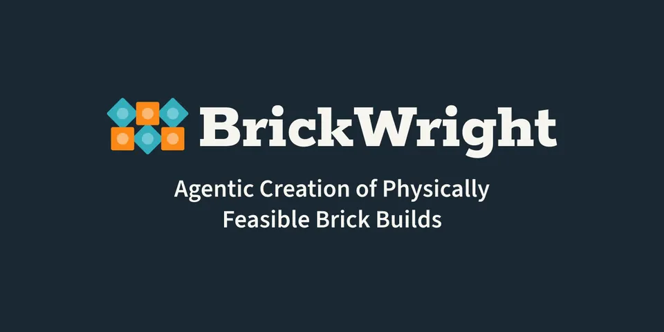

# BrickWright

***Agentic Creation of Physically Feasible Brick Builds***  
[Ava Pun](https://avapun.com/)<sup>1</sup>,
[Kevin Dai](https://github.com/K1ngHungry)<sup>1</sup>,
[Sally Chen](https://sally-chen.github.io/)<sup>1</sup>,
[Maxwell Jones](https://maxwelljon.es/)<sup>1</sup>,
[Ruixuan Liu](https://waynekyrie.github.io/)<sup>1</sup>,
[Kangle Deng](https://dunbar12138.github.io/)<sup>2</sup>,
[Changliu Liu](https://www.ri.cmu.edu/ri-faculty/changliu-liu/)<sup>1</sup>,
[Maneesh Agrawala](https://graphics.stanford.edu/~maneesh/)<sup>3</sup>,
[Deva Ramanan](https://www.cs.cmu.edu/~deva/)<sup>1</sup>,
[Jun-Yan Zhu](https://www.cs.cmu.edu/~junyanz/)<sup>1</sup>  
<sup>1</sup>Carnegie Mellon University, <sup>2</sup>Independent researcher, <sup>3</sup>Stanford University

[](https://arxiv.org/abs/2610.31651)
[](https://avalovelace1.github.io/brickwright/)
[](https://pypi.org/project/brickwright/)
[](https://github.com/AvaLovelace1/brickwright/blob/main/LICENSE)

---



**BrickWright** enables pre-trained coding agents to generate high-fidelity, _physically feasible_ LEGO® builds from
text or image prompts by writing code with **BrickLayer**, a Python toolkit for build creation and validation. Whereas
baseline agents achieve physical validity rates ranging from only 9% (GPT-6 Luna) to 69% (GPT-6 Astra),
BrickWright-guided agents achieve **100% validity** on a sample of 512 prompts, while improving prompt adherence for
lightweight agents and maintaining it for stronger agents.

This repository contains two packages:

| Package                                 | Description                                                                                                                                                                       |
|-----------------------------------------|-----------------------------------------------------------------------------------------------------------------------------------------------------------------------------------|
| [**bricklayer**](packages/bricklayer)   | An SDK for programmatically creating and validating LEGO builds. Assemble builds from real catalog parts, check them for validity, and export to [LDraw](https://www.ldraw.org/). |
| [**brickwright**](packages/brickwright) | A framework that guides an LLM agent to generate LEGO builds with BrickLayer.                                                                                                     |

## Quickstart

1. Download this repo: `git clone https://github.com/AvaLovelace1/brickwright.git`.
2. Ask your favorite agent (Codex, Claude Code, etc.) to create a brick build following
   the [packages/brickwright README](packages/brickwright/README.md).
3. Have fun!

## Development

Contributing? Make sure to run tests, lint, format, and type-check before submitting a PR:

```sh
uv run pytest          # run the full test suite
uv run ruff check .    # lint
uv run ruff format .   # format
uv run ty check        # type-check
```

## Related & concurrent work

Check out these other awesome papers on LEGO® generation!

- [BrickBench: Evaluating Agentic Brick Design](https://brickben.ch) (October 2026)—a benchmark and environment for agentic LEGO® design
- [BrickNet: Graph-Backed Generative Brick Assembly](https://kulits.github.io/BrickNet/) (April 2026)
- [LegoACE: Autoregressive Construction Engine for Expressive LEGO® Assemblies](https://dl.acm.org/doi/10.1145/3757377.3763881) (December 2025)
- [LEGO®-Maker: Autoregressive Image-Conditioned LEGO® Model Creation](https://dl.acm.org/doi/10.1145/3763285) (December 2025)
- [Generating Physically Stable and Buildable Brick Structures from Text](https://avalovelace1.github.io/BrickGPT/) (May 2025)
- [Learn to Create Simple LEGO Micro Buildings](https://dl.acm.org/doi/10.1145/3687755) (November 2024)

## Citation

If you've used BrickWright in your work, please cite us!

```bibtex
@misc{pun2026brickwright,
  title = {BrickWright: Agentic Creation of Physically Feasible Brick Builds},
  author = {Pun, Ava and Dai, Kevin and Chen, Sally and Jones, Maxwell and Liu, Ruixuan and Deng, Kangle and Liu, Changliu and Agrawala, Maneesh and Ramanan, Deva and Zhu, Jun-Yan},
  year = {2026},
  eprint = {2610.31651},
  archivePrefix = {arXiv},
}
```

## Acknowledgments

This work is partly supported by the Packard Foundation, Sloan Foundation, and IITP grant funded by the Korean
Government (MSIT) (No. RS-2024-00457882, National AI Research Lab Project). Ava Pun is supported by the Meshy
Fellowship, Tata Consultancy Services Presidential Fellowship, and NSERC CGRS D. Maxwell Jones is supported by the
Rales Fellowship.

---

*LEGO® is a trademark of the LEGO Group, which does not sponsor, authorize, or endorse this project.*
